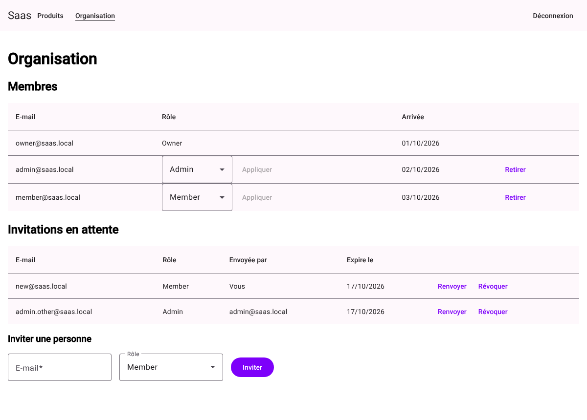
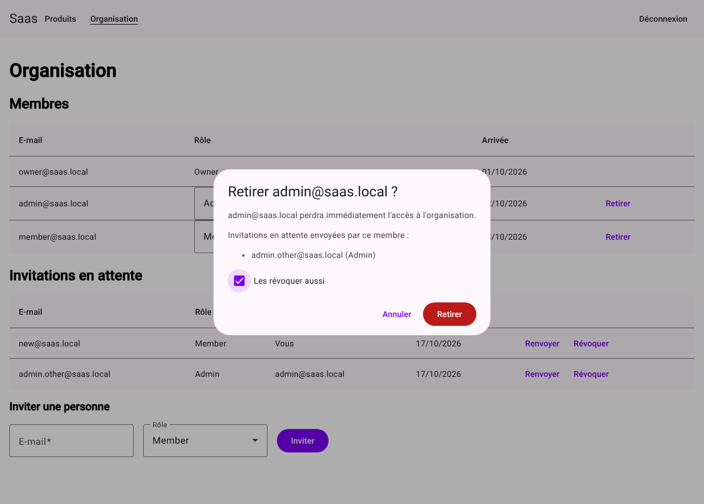

# web-angular

Angular 22 front end of the starter: standalone components, zoneless change detection, signals and Angular Material.

## Run

Start the API first (see the Quickstart in the root `README.md`), then:

```bash
npm ci
npm start   # http://localhost:4200
```

`src/proxy.conf.json` forwards `/api` and `/openapi` to the API on port 5123, so the front end and the API share one origin. The refresh-token cookie relies on it (`docs/adr/0004`).

## Layout

| Folder                          | Content                                                                                                                                                                                                                                                                                                                              |
| ------------------------------- | ------------------------------------------------------------------------------------------------------------------------------------------------------------------------------------------------------------------------------------------------------------------------------------------------------------------------------------ |
| `src/app/core/auth`             | Auth service (access token in memory, refresh through the HttpOnly cookie, organization and role read from the token for display), route guards (signed in; Owner or Admin), interceptor that refreshes on a 401 and replays the request once (a single shared refresh), one refresh at a time across the browser's tabs (Web Locks) |
| `src/app/core/error`            | Global error handler and HTTP error interceptor                                                                                                                                                                                                                                                                                      |
| `src/app/features/auth`         | Login, registration, e-mail confirmation, forgotten and reset password pages                                                                                                                                                                                                                                                         |
| `src/app/features/products`     | Products page, the sample tenant-scoped feature: list, add, edit, delete                                                                                                                                                                                                                                                             |
| `src/app/features/invitations`  | Invitation acceptance page, opened from the link of the invitation e-mail                                                                                                                                                                                                                                                            |
| `src/app/features/organization` | Organization page, for the Owner and Admins: members (role change and removal by the Owner), pending invitations (invite, resend, revoke)                                                                                                                                                                                            |
| `src/app/api/generated`         | TypeScript types generated from `openapi.json` (not versioned)                                                                                                                                                                                                                                                                       |
| `src/app/testing`               | Test helpers: a signed-in session with a given role, a Web Locks manager for jsdom                                                                                                                                                                                                                                                   |

## Products

Known limit of the edit: the API does not receive the version of the product the page read, so when two people edit the same product one after the other, both starting from the same version, the second save overwrites the first without warning. The 409 only covers two saves landing at the same moment.

## Screens

The Organization page as the Owner sees it, and the confirmation of a member's removal. The screenshots come from the Playwright tests' mocked API.





## API types

`openapi.json` is the versioned API contract, written by the API build (`dotnet build src/Api`); CI fails when it is out of date. `npm run api:gen` generates the TypeScript types from it with Hey API; `npm start`, `npm test`, `npm run test:coverage`, `npm run watch`, `npm run check` and `npm run build` run it first; the other scripts expect the types to be generated already.

## Commands

| Command               | Purpose                                                                                                                                                       |
| --------------------- | ------------------------------------------------------------------------------------------------------------------------------------------------------------- |
| `npm run check`       | CI gate: type generation, Prettier, ESLint, Stylelint, type check (`npm run typecheck`: the app, the unit tests, both Playwright suites and the tool configs) |
| `npm run fix`         | Prettier, ESLint and Stylelint fixes                                                                                                                          |
| `npm test`            | Unit tests (Vitest)                                                                                                                                           |
| `npm run e2e`         | Playwright tests of the login, invitation acceptance, Products and Organization pages with axe accessibility checks; the API is mocked, no backend needed     |
| `npm run e2e:backend` | The end-to-end journey against the real backend, with axe checks; PostgreSQL, Mailpit and the API must be running (see CONTRIBUTING.md § Tests)               |
| `npm run build`       | Production build in `dist/`                                                                                                                                   |
